# pfib-synth

**Synthetic pFIB-SEM stacks of porous catalyst layers, with exact ground truth for every pixel.**

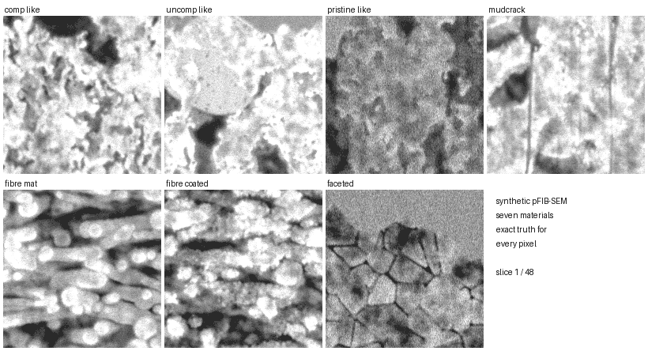

In a pFIB-SEM stack, the beam images the cut face at 52°, so a pore does not look black: you see its lit floor or far wall a few slices down. This is *shine-through*. A pore whose floor is one slice down looks almost like solid. Hand labels and threshold rules call it solid, and every model trained on those labels learns to do the same. On real data nobody can measure how often this happens, because nobody knows the answer.

This generator builds a 3-D material, mills it slice by slice the way the microscope does, and renders each cut face with the beam geometry, the depth response and the detector measured on the team's three real acquisitions (comp, uncomp, pristine). The truth is known exactly, so the shine-through error can be measured instead of argued about.

```bash
pip install -r requirements.txt
python generate.py --list
python generate.py comp_like --frames 40 --width 512     # ~1 min, writes out/comp_like/
python generate.py fibre_mat                              # full 118-frame package, ~6 min
```

Each package matches the team's review packages: an image stack `synth_<material>_full.tif` and truth masks `truth/masks/slice_NNNN.png` (0 = pore, 255 = solid, 128 = outside the layer, the encoding `eponge.io.export_to_classes` reads). `start_masks/` holds what the threshold rule behind our labels would have drawn, and `truth.json` holds every setting and the true porosity. No real data is needed to generate. The calibrated constants (`optics_v5.json`, `geometry.json`, `slicing.json`, ...) were measured on the real stacks once. The one thing the generator used to read from them at run time, the layer's grey-level histogram, now ships as `pfibsynth/real_tone.json`. A stack generated from this repo is byte-identical to one from the original working copy (tested on a 10 × 630 × 320 comp stack with the real stacks hidden).

## Materials

Three are calibrated to our real stacks. Four are never used in training and test whether a model learned shine-through or just learned our three materials.

| | image · truth · truth on image |
|---|---|
| **comp-like**: Voronoi-foam catalyst, sparse large voids, calibrated to comp | 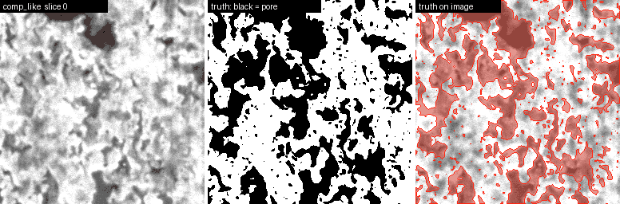 |
| **uncomp-like**: coarser open foam, calibrated to uncomp | 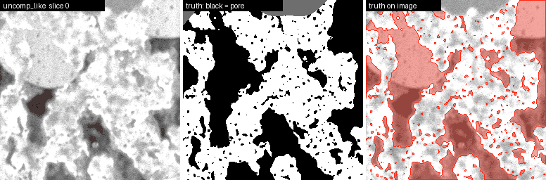 |
| **pristine-like**: finer foam, pristine's detector and contrast | 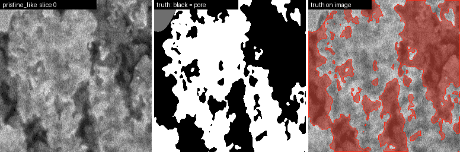 |
| **mudcrack** (held out): a 3-D crack network through the layer | 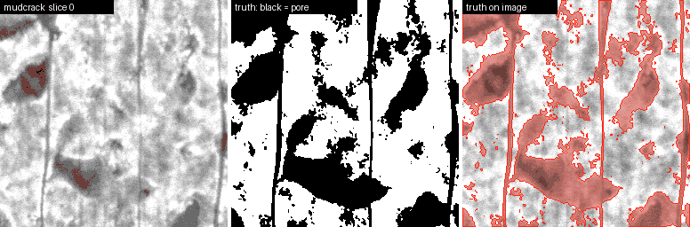 |
| **fibre mat** (held out): stacked fibres, rims brighter than cores | 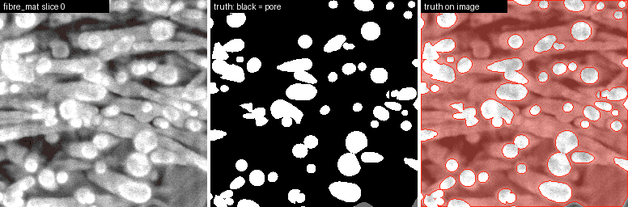 |
| **coated fibre** (held out): fibres decorated with particles and binder | 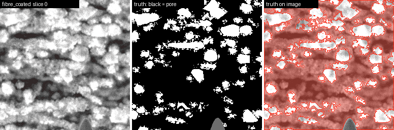 |
| **faceted** (held out): sintered polycrystal, a grey level per grain, pores at junctions | 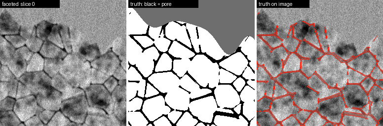 |

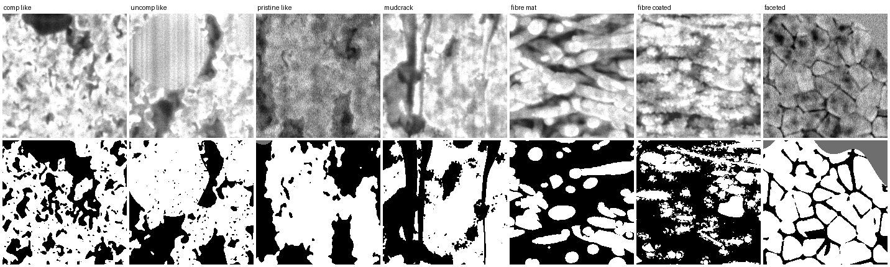

## How a stack is made

The generator mimics the process rather than the look. The look follows from the process.

1. **One material, milled.** The material is a 3-D volume. Each frame is the face left after removing one slice, and a slice is thinner than a pixel: about 0.8–0.9 px of material per slice, fitted to how fast real structure decorrelates between frames. Coarse structure stretches further along the milling axis than fine structure, as in the real stacks. Cutting through an x–z plane gives one continuous object, not a stack of unrelated pictures:

   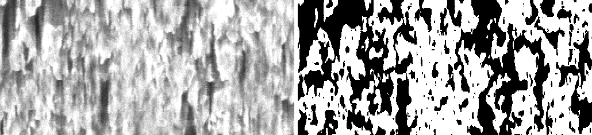

2. **The beam comes in at 52°.** For every pore pixel, the renderer traces down the beam into the volume until it hits solid. The brightness falls off with that depth (fitted shine-through curve), with the secant of the wall, and with edge escape. Edge escape is directional: a pore's top edge overhangs and blooms, its bottom edge does not, so the top/bottom contrast matches real frames (1.22 vs 1.24 on comp). The frame drifts about 1.1 px per slice, and buried surfaces move a further 0.2–0.3 px per slice (parallax). In real stacks you can watch a pore's floor come forward from the back over several slices; here it is the same geometry.

3. **One-sided change.** As cover thins, a surface brightens gradually; when the beam cuts through, a pore opens all at once. So sudden darkenings outnumber sudden brightenings (11:1 on real comp), and the renderer reproduces this, although more weakly than real (below).

4. **Outside the layer.** The support, cap, caverns and voids under the layer are 3-D ellipsoids, ray-traced to their far wall, with the glow under an overhanging top edge. Curtaining stripes evolve regionally between slices. The stage jitters about 0.2 px per frame (measured). Detector noise is scan-correlated, and the detector saturates after the noise, not before.

5. **Noise or pores.** Speckle that does not survive one slice matches the noise on the featureless cap: that is noise. Specks of 1–3 px that persist across slices are micropores, and they go in the truth, not in a painted texture.

Every constant has a measurement behind it, and the reasoning for each is in [`pfibsynth/slicing.json`](pfibsynth/slicing.json) (`_why`, `_v7*` notes) and the module docstrings.

## How real does it look

Each test is a classifier trained to tell synthetic from real, scored against a real-vs-real control: a second classifier trained to tell two halves of the same real stack apart. AUC 0.5 means it cannot tell them apart; 1.0 means it always can.

| full-length stack | single frame (control) | 9-slice clips (control) | x–z reslices | arrow of time: synthetic / held-out real |
|---|---|---|---|---|
| comp | 0.86 (0.55) | 0.97 (0.51) | 0.72 | 0.99 / 1.00 |
| uncomp | 0.93 (0.58) | 0.88 (0.62) | 0.83 | 0.97 / 0.97 |
| pristine | 0.97 (0.56) | 0.90 (0.57) | 0.98 | 0.94 / 0.98 |

It is not indistinguishable yet. A classifier still separates every stack, most easily through the slices. The arrow-of-time model was trained on real clips to tell forward from reversed, and it recognises synthetic clips as forward almost as reliably as real ones, so the cutting physics is right. Two known gaps remain:

* The one-sided darkening is weaker than real (skew −1.1 vs −1.9 on comp).
* Pristine reslices are easy to spot.

Coherence along the beam does match. Take a pore pixel today; how strongly does it correlate with the image 4, 8 and 12 slices later? Comp gives 0.84/0.74/0.65 against real 0.86/0.75/0.66, and pristine gives 0.87/0.79/0.72 against real 0.86/0.77/0.72. The scorecards (`pfibsynth/scorecard.py`, `temporal_scorecard.py`) need the real stacks; point `PFIB_REAL_DIR` and `PFIB_LABELS_DIR` at them.

## Experiment: the team's best model, scored on exact truth

MillNet-SA2 is the team's best model: 0.935 mIoU against hand labels on the real test frames, 3 seeds. I ran it exactly as reported (team code at commit `7892e9e`, `segment_stack`, 1024 px tiles, k = 3, flip TTA) on 16 frames of each of the seven packages above. Next to it are the threshold rule our labels came from and two U-Nets trained only on synthetic stacks. All are scored against the exact truth, in the team's shared metrics.

| (mean over 7 materials) | recall, floor 1 / 2–3 / 4–8 / >8 slices down | solid correct | in-layer pore IoU | \|porosity error\|, all / 4 held out | 3-class mIoU | layer IoU |
|---|---|---|---|---|---|---|
| threshold rule (our labels) | 0.26 / 0.40 / 0.62 / 0.92 | 0.83 | 0.62 | 9.2 / 14.0 pp | 0.76 | (from truth) |
| **MillNet-SA2**, real labels, 3 seeds | 0.29 / 0.45 / 0.66 / 0.89 | 0.77 | 0.59 | 11.1 / 15.6 pp | 0.71 | 0.95 |
| 1-slice U-Net, synthetic | 0.54 / 0.71 / 0.87 / 0.98 | 0.88 | 0.78 | 2.8 / 3.1 pp | – | – |
| 9-slice U-Net, synthetic | **0.66 / 0.83 / 0.93** / 0.97 | **0.93** | **0.85** | **1.6 / 1.3 pp** | – | – |

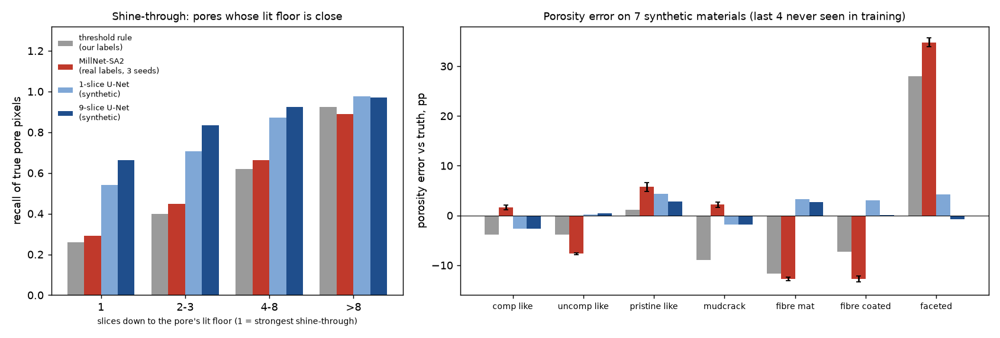

**On real frames MillNet is the rule; on exact truth the rule misses most shallow pores.** On the real test frames (101–117), MillNet's pores agree with the threshold rule's at pore IoU 0.91–0.96 inside the layer (3 seeds, `experiments/real_control.py`). A model that close to the rule inherits the rule's misses. On synthetic stacks, where the truth is known, the same rule misses 74% of pores whose floor is one slice down and 60% at two to three slices. The rule's miss rate on real frames cannot be measured, but nothing suggests real shine-through is easier, so 0.935 mIoU most likely measures agreement with labels that are blind to shallow shine-through.

On the synthetic stacks themselves, MillNet behaves like the rule: it misses the shallowest pores at the rule's rate (0.29 vs 0.26 recall), and its porosity errors follow the rule's on fibres (−12.7 pp) and faceted grains (+35 pp). The three seeds agree within 1 pp, so this is systematic. But its agreement with the rule falls from 0.91–0.96 on real frames to 0.69–0.84 on synthetic, and it calls more solid as pore than the rule does (0.77 vs 0.83 solid correct). So part of what it does on synthetic is domain shift, and these synthetic numbers are not an estimate of its error on real data.

Two caveats limit how far this goes:

* **Matched renderer.** The synthetic U-Nets were trained on this renderer and MillNet was not, so part of their lead is a matched-renderer advantage. The same effect showed up as 2.9 vs 15.6 pp in the earlier cross-renderer test.
* **Synthetic is still distinguishable from real** (table above). This is the same domain shift.

The rule's layer IoU is 1.0 only because start masks take the layer outline from the truth.

On the real stacks, the 9-slice synthetic model gives porosity 0.382 / 0.479 / 0.511 against labels of 0.397 / 0.512 / 0.501. So the shine-through correction does not simply raise real porosity, and real porosity remains unsettled.

Reproduce with `experiments/score_millnet.py` (needs the team repo at `eponge-v2` and the checkpoints; see its docstring), then `experiments/plot_millnet.py`. Results are in `experiments/millnet_on_synth_v7d.json`.

## Training on it

`pfibsynth/shine_data.py` builds training volumes with randomised style, porosity and ±25% jittered settings. `pfibsynth/train_shine.py` trains the team's U-Net on them (`--config zwin_random_v7` for 9-slice input, `2d_random_v7` for 1 slice). It needs `torch`; the team U-Net it trains is vendored as `pfibsynth/team_unet.py`. The two checkpoints used above are in `pfibsynth/checkpoints/`.

## Layout

```
generate.py              presets for the seven materials -> pfibsynth/make_full.py
pfibsynth/
  make_full.py           build + render a full stack, write the package
  materials.py           foam, mudcrack, fibre, faceted material builders
  context.py             layout outside the layer: support, cap, voids, caverns
  microscope.py, v4.py   beam / depth response / edge escape / detector
  make_package.py        package writer and the threshold-rule start masks
  slicing.json           per-acquisition slicing and realism settings, with the reasons
  optics_v5.json, geometry.json, real_tone.json, ...   calibrated constants
  scorecard.py, temporal_scorecard.py    realism discriminators (need real data)
  shine_data.py, train_shine.py, shine_depth_eval.py  training and evaluation
experiments/             MillNet-SA2 on exact truth: driver, results, plot
tools/                   README media, truth GIFs, coming-forward coherence
docs/media/              everything shown above
```

| variable | what | needed for |
|---|---|---|
| `PFIB_OUT` | where packages are written and read back (default `out/`) | evaluation |
| `PFIB_REAL_DIR` | `comp_full.tif`, `uncomp_full.tif`, `pristine_full.tif` | realism scoring, recalibration |
| `PFIB_LABELS_DIR` | the team's labelled review packages | realism scoring, recalibration |

## Where this sits in the team's work

The Éponge team compares four lines of work on the same dataset and split:

* Aaditya: architecture (MillNet-SA2).
* Dhruv: unseen acquisitions.
* Yunzhi: porosity calibration.
* Hou Kin: this generator, the experiments where the answer is known.

The team's findings call for scoring MillNet-SA2 on these packages, and the experiment above does that. Still open from that list:

* Score models trained on Aaditya's learned-appearance digital twin on these packages, and ours on the twin.
* Train MillNet-SA2 on synthetic data and repeat this test.
* Check whether Yunzhi's validation-calibrated decoder, which fits the labels, moves porosity toward or away from the truth.
